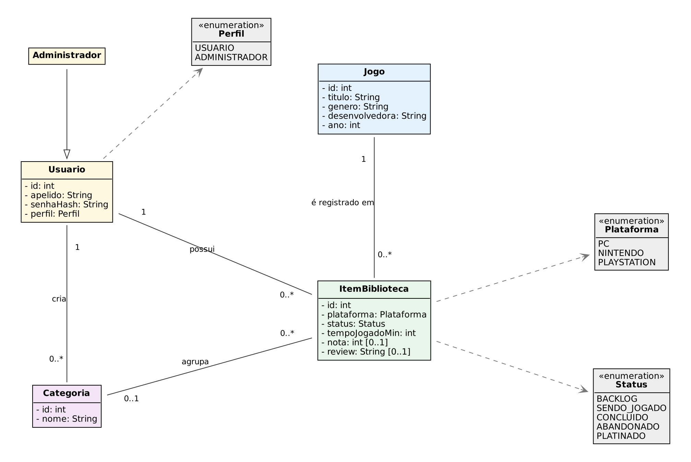
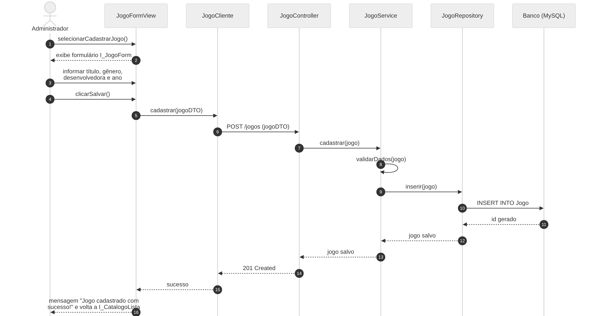
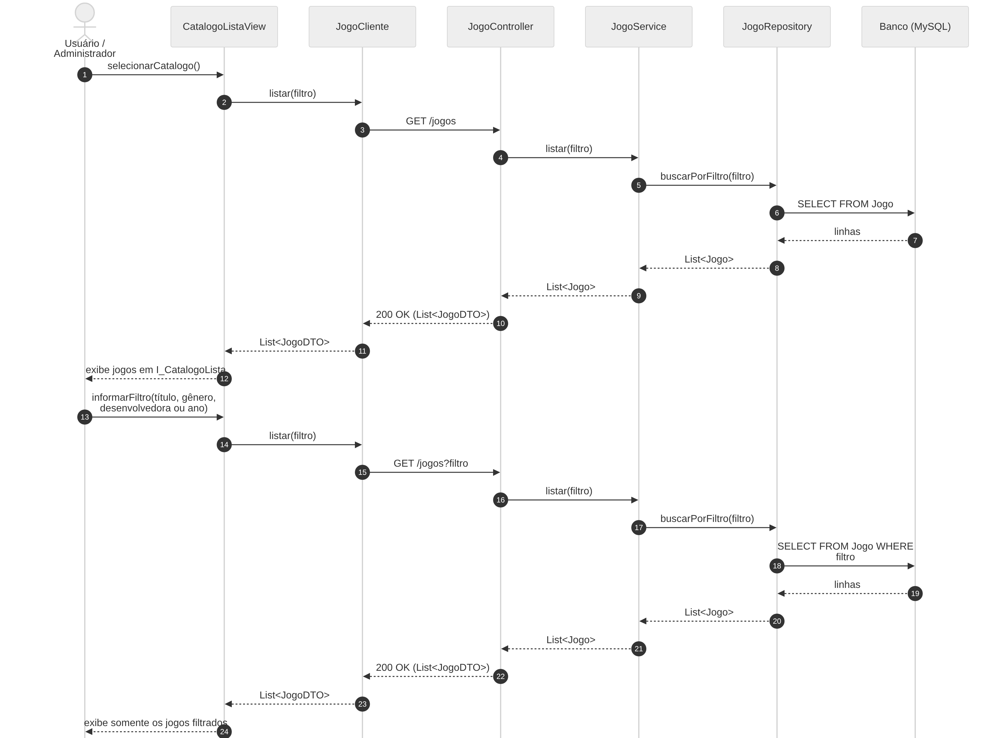
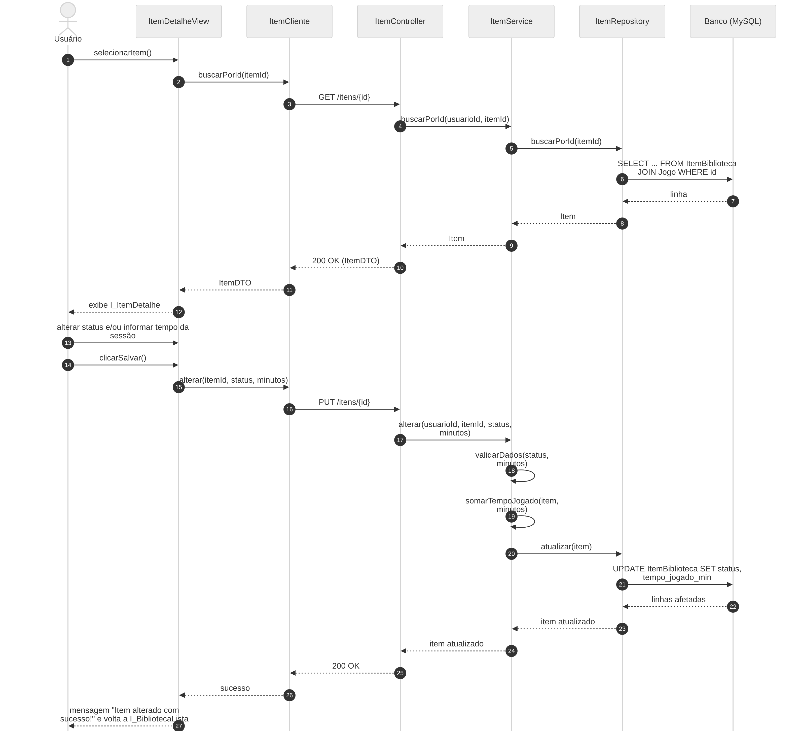

# 🎮 GameTrack

Sistema usado para registrar jogos zerados, platinados ou sendo jogados pelo usuário. Também permite organizar os jogos em bibliotecas e escrever reviews sobre os mesmos.

## 1. Contexto do Problema e Solução

### 1.1 Problema
Ao jogar videogames, jogadores que possuem mais de uma plataforma (PC, Nintendo, PlayStation) acabam tendo bibliotecas fragmentadas, dificultando a gestão de todos os títulos adquiridos.

O jogador também perde controle sobre status de conclusão dos seus jogos, de quanto tempo investiu neles e sobretudo sobre quais jogos quer jogar em seguida.

### 1.2 Solução
O GameTrack busca solucionar esses problemas ao oferecer uma biblioteca única, atuando como centro da coleção do usuário. O jogador também pode separar os seus jogos de acordo com plataforma, gênero, status de conclusão, ou criar suas próprias categorias para organizar de acordo com o seu interesse. O sistema conta com tags especiais que o usuário pode aplicar aos jogos, como _BackLog_, _Concluído_, _Sendo Jogado_, _Abandonado_, _Platinado_. Além disso, também é possível escrever reviews e atribuir notas aos jogos concluídos.

### 1.3 Funcionalidades
- Cadastrar, consultar, atualizar e excluir os jogos na biblioteca do usuário
- Organizar por plataforma, gênero e status
- Criar categorias personalizadas a gosto do usuário, como _Jogos para jogar com os amigos_, _Jogos difíceis_
- Aplicar tags de status (_BackLog_, _Concluído_, _Sendo Jogado_, _Abandonado_, _Platinado_)
- Fazer reviews e notas de 1 estrela a 5 estrelas para jogos concluídos
- Registrar o tempo jogado

## 2. Instruções para Uso

_Em construção_

## 3. Instruções para DEVs

_Em construção_

## 4. Tecnologias
- Frontend:
  - Swing
- Backend:
  - Java 25
- Banco de Dados:
  - MySQL 9.7 LTS
- IDE:
  - VSCode

## 5. Organização do Projeto

### 5.1 Diagrama de classes do domínio

Principais classes do domínio, com atributos, relacionamentos e multiplicidades.

### 5.2 Diagrama de pacotes

Organização das pastas do projeto e dependências entre os pacotes do front (Swing) e do back (Java).

### 5.3 Diagramas de sequência

Cada diagrama mostra a ordem das chamadas entre tela, cliente, controller, service, repository e banco para executar uma funcionalidade. Os requisitos RF003 a RF006 correspondem ao CRUD do catálogo de jogos, e os RF007 a RF010, ao CRUD da biblioteca do usuário.

#### 5.3.1 Catálogo de jogos

**RF003 – Cadastrar jogo no catálogo**

**RF004 – Listar jogos do catálogo**

**RF005 – Alterar jogo do catálogo**

**RF006 – Excluir jogo do catálogo**

#### 5.3.2 Biblioteca do usuário

**RF007 – Cadastrar item na biblioteca**

**RF008 – Consultar itens da biblioteca**

**RF009 – Alterar item da biblioteca**

**RF010 – Excluir item da biblioteca**

