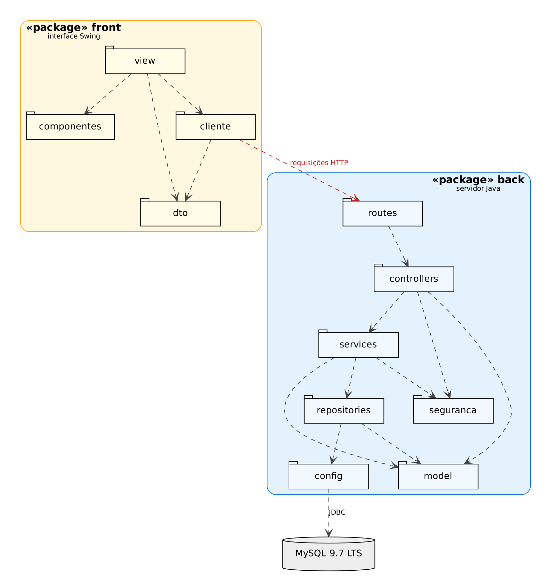
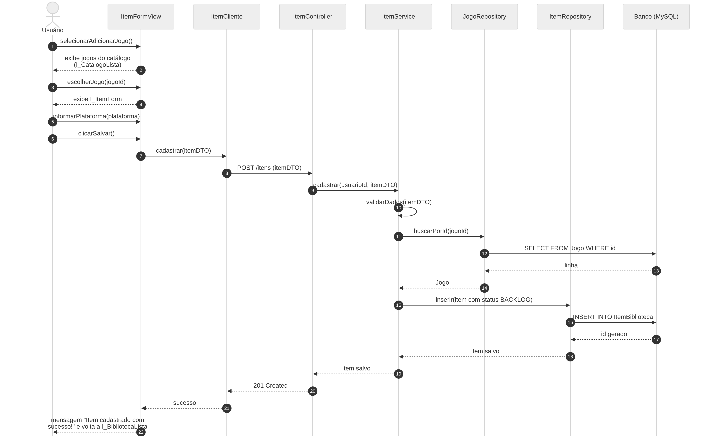
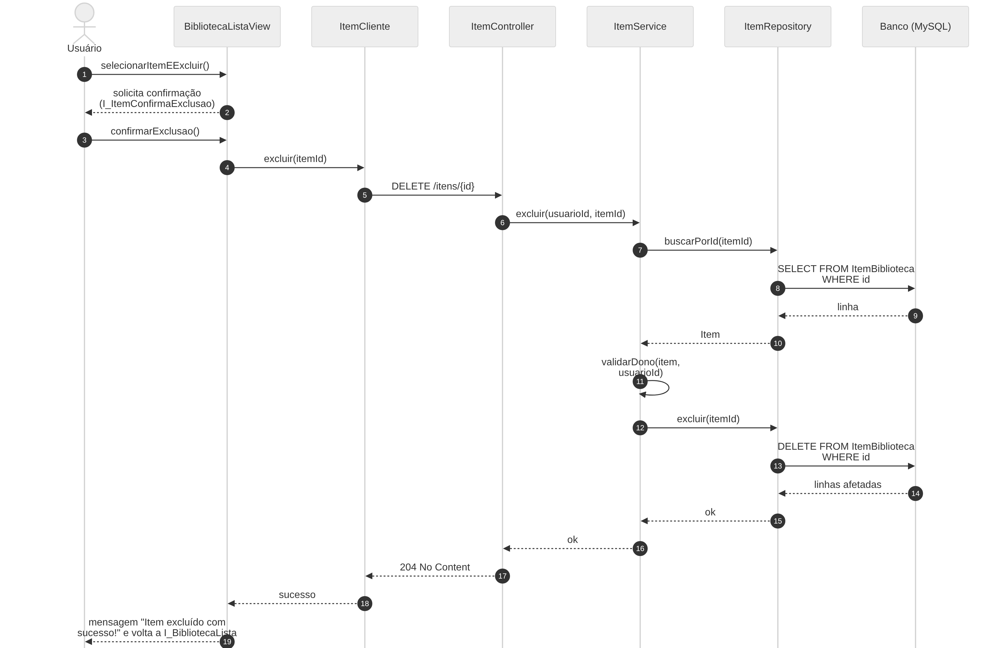

# 🎮 GameTrack

Sistema usado para registrar jogos zerados, platinados ou sendo jogados pelo usuário. Também permite organizar os jogos em bibliotecas e escrever reviews sobre os mesmos.

> **Status:** projeto em desenvolvimento. A especificação e o projeto estão documentados, e a implementação está em andamento, a começar pelo CRUD do catálogo de jogos.

## 1. Contexto do Problema e Solução

### 1.1 Problema
Ao jogar videogames, jogadores que possuem mais de uma plataforma (PC, Nintendo, PlayStation) acabam tendo bibliotecas fragmentadas, dificultando a gestão de todos os títulos adquiridos.

O jogador também perde controle sobre status de conclusão dos seus jogos, de quanto tempo investiu neles e sobretudo sobre quais jogos quer jogar em seguida.

### 1.2 Solução
O GameTrack busca solucionar esses problemas ao oferecer uma biblioteca única, atuando como centro da coleção do usuário. O jogador também pode separar os seus jogos de acordo com plataforma, gênero, status de conclusão, ou criar suas próprias categorias para organizar de acordo com o seu interesse. O sistema conta com tags especiais que o usuário pode aplicar aos jogos, como _BackLog_, _Concluído_, _Sendo Jogado_, _Abandonado_, _Platinado_. Além disso, também é possível escrever reviews e atribuir notas aos jogos concluídos.

O sistema tem um **catálogo global** de jogos, mantido pelo administrador e compartilhado por todos os usuários. Cada usuário monta a sua **biblioteca** escolhendo jogos do catálogo e informando a plataforma em que joga.

### 1.3 Funcionalidades
- Criar uma conta e se autenticar
- Manter o catálogo de jogos (cadastrar, consultar, alterar e excluir), função do administrador
- Montar a biblioteca pessoal com jogos do catálogo, informando a plataforma
- Consultar, atualizar e excluir os itens da biblioteca
- Organizar por plataforma, gênero e status
- Criar categorias personalizadas a gosto do usuário, como _Jogos para jogar com os amigos_, _Jogos difíceis_
- Aplicar tags de status (_BackLog_, _Concluído_, _Sendo Jogado_, _Abandonado_, _Platinado_)
- Fazer reviews e notas de 1 estrela a 5 estrelas para jogos concluídos
- Registrar o tempo jogado

## 2. Instruções para Uso

_Em construção_

## 3. Instruções para DEVs

### 3.1 Pré-requisitos
- JDK 25
- Maven 3.9 ou superior
- MySQL 9.7 LTS
- VSCode, com a extensão Extension Pack for Java

### 3.2 Configuração do ambiente
1. Crie o banco e as tabelas: `mysql -u <usuario> -p < sql/01_criar_tabelas.sql`.
2. Copie `back/src/main/resources/config.example.properties` para `back/src/main/resources/config.properties` e preencha o usuário e a senha do seu MySQL. O arquivo `config.properties` é ignorado pelo Git.
3. Compile e rode os testes na raiz do projeto: `mvn clean package`.

_As instruções de execução do servidor e da interface serão adicionadas junto com o código._

### 3.3 Como contribuir
O trabalho em equipe segue os padrões definidos na pasta [`Padrões Adotados`](Padrões%20Adotados):

| Assunto | Resumo | Documento |
|---|---|---|
| Git | A `main` só recebe mudanças por pull request. Cada requisito tem uma branch própria (`feat/rf003-cadastrar-jogo`), e outro integrante revisa antes do merge. | [Padrões de Uso do Git](Padrões%20Adotados/Padrões%20de%20Uso%20do%20Git.md) |
| Commits | Formato `:emoji: tipo(escopo): Descrição`, com o código do requisito no escopo. Exemplo: `:sparkles: feat(RF003): Cadastro de jogo no catálogo`. | [Padrões de Uso do Git](Padrões%20Adotados/Padrões%20de%20Uso%20do%20Git.md) |
| Código | 10 regras de codificação: notação de nomes, Javadoc, métodos pequenos, SOLID, exceções, SQL parametrizado, entre outras. | [Padrões de Codificação](Padrões%20Adotados/Padrões%20de%20Codificação.md) |
| Requisitos | Regras de verificação e análise aplicadas a cada requisito. | [Regras de Verificação e Análise de Requisitos](Padrões%20Adotados/Regras%20de%20Verificação%20e%20Análise%20de%20Requisitos.md) |

### 3.4 Acompanhamento das tarefas
As tarefas estão no quadro Kanban do projeto, na aba **Projects** do repositório. Cada tarefa é uma issue cujo nome começa com o código do requisito (por exemplo, `[RF003] Cadastrar jogo no catálogo`). A tarefa vai para **Desenvolvendo** ao ser iniciada, passa por **Teste de Sistema** e termina em **Finalizado**.

## 4. Tecnologias
- Frontend:
  - Swing
- Backend:
  - Java 25
- Banco de Dados:
  - MySQL 9.7 LTS
- IDE:
  - VSCode
- Versionamento e gestão:
  - Git e GitHub (issues, pull requests e Projects)

## 5. Organização do Projeto

### 5.1 Estrutura de pastas

O projeto é um Maven com dois módulos, `back` (servidor Java) e `front` (interface Swing).

```
GameTrack/
├── README.md
├── .gitignore
├── pom.xml                        Projeto Maven pai
├── back/                          Servidor Java
│   ├── pom.xml
│   └── src/
│       ├── main/java/gametrack/back/   routes, controllers, services, repositories,
│       │                               model, config, seguranca
│       ├── main/resources/             config.example.properties
│       └── test/java/gametrack/back/   Testes
├── front/                         Interface Swing
│   ├── pom.xml
│   └── src/
│       ├── main/java/gametrack/front/  view, componentes, cliente, dto
│       └── test/java/gametrack/front/  Testes
├── sql/                           Scripts do banco de dados (MySQL)
├── docs/
│   └── diagramas/                 Diagramas de classes, de pacotes e de sequência
├── Requisitos/                    Documento de requisitos
└── Padrões Adotados/              Regras e padrões da equipe
    └── registros/                 Revisões de requisitos, por data
```

Os pacotes internos de cada módulo estão no diagrama de pacotes (seção 5.3). A documentação completa do sistema está em [`Requisitos/Documento_de_Requisitos_GameTrack.docx`](Requisitos/Documento_de_Requisitos_GameTrack.docx), com os requisitos funcionais e não funcionais, a rastreabilidade entre telas e requisitos, o protótipo no Figma e o dicionário de dados.

### 5.2 Diagrama de classes do domínio

Principais classes do domínio, com atributos, relacionamentos e multiplicidades.


### 5.3 Diagrama de pacotes

Organização das pastas do projeto e dependências entre os pacotes do front (Swing) e do back (Java).



### 5.4 Diagramas de sequência

Cada diagrama mostra a ordem das chamadas entre tela, cliente, controller, service, repository e banco para executar uma funcionalidade. Os requisitos RF003 a RF006 correspondem ao CRUD do catálogo de jogos, e os RF007 a RF010, ao CRUD da biblioteca do usuário.

#### 5.4.1 Catálogo de jogos

**RF003 – Cadastrar jogo no catálogo**


**RF004 – Listar jogos do catálogo**


**RF005 – Alterar jogo do catálogo**


**RF006 – Excluir jogo do catálogo**


#### 5.4.2 Biblioteca do usuário

**RF007 – Cadastrar item na biblioteca**



**RF008 – Consultar itens da biblioteca**


**RF009 – Alterar item da biblioteca**


**RF010 – Excluir item da biblioteca**

