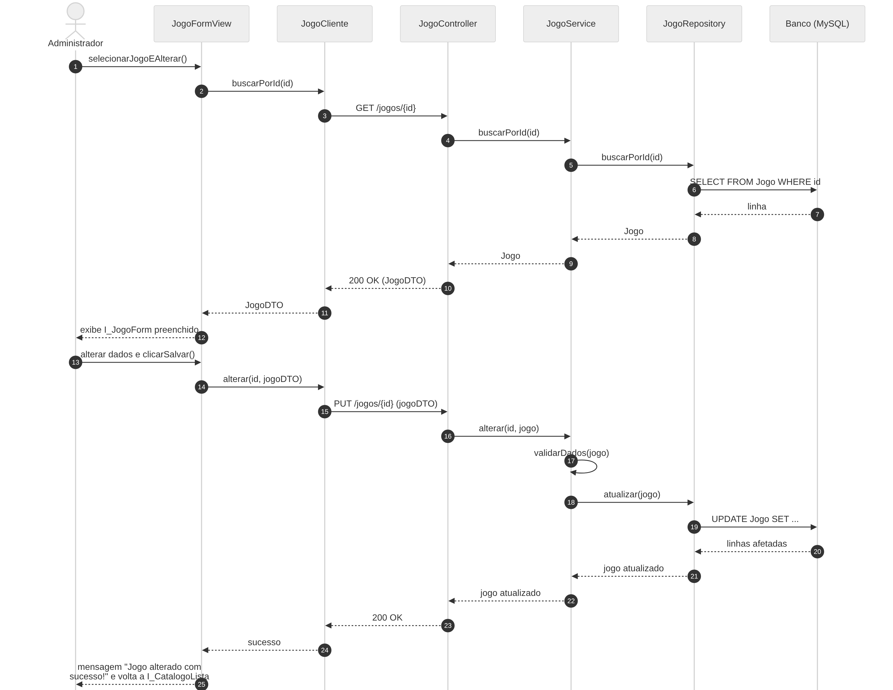
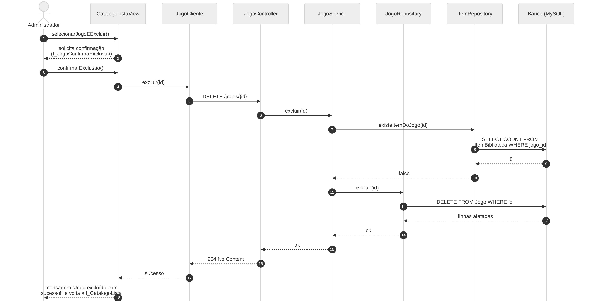
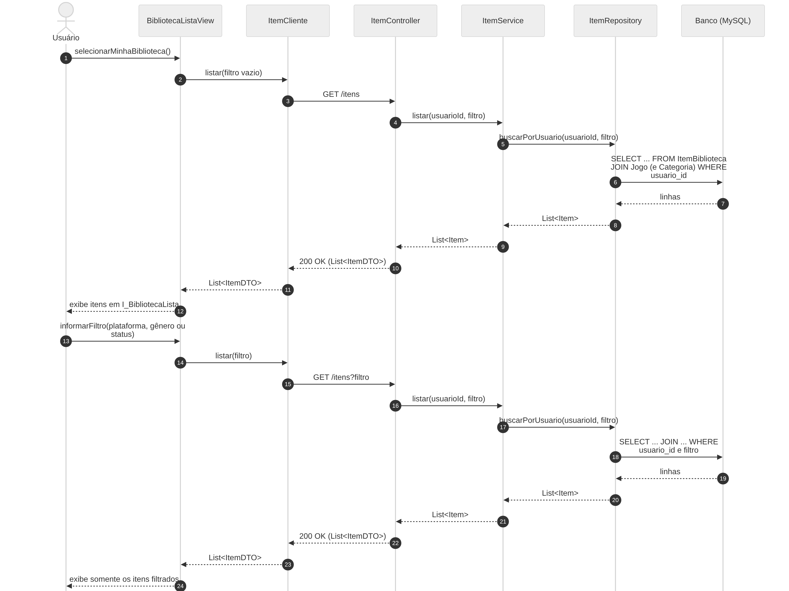
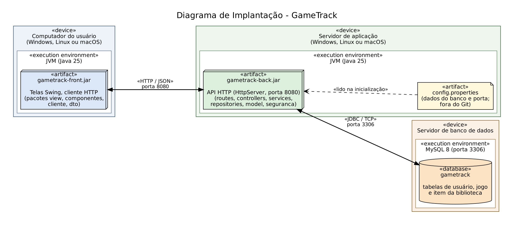

# 🎮 GameTrack

Sistema usado para registrar jogos zerados, platinados ou sendo jogados pelo usuário. Também permite organizar os jogos em bibliotecas e escrever reviews sobre os mesmos.

> **Status:** projeto em desenvolvimento. As contas (cadastro e login) e o CRUD do catálogo de jogos estão implementados. A próxima etapa é a biblioteca do usuário.

## 1. Contexto do Problema e Solução

### 1.1 Problema
Ao jogar videogames, jogadores que possuem mais de uma plataforma (PC, Nintendo, PlayStation) acabam tendo bibliotecas fragmentadas, dificultando a gestão de todos os títulos adquiridos.

O jogador também perde controle sobre status de conclusão dos seus jogos, de quanto tempo investiu neles e sobretudo sobre quais jogos quer jogar em seguida.

### 1.2 Solução
O GameTrack busca solucionar esses problemas ao oferecer uma biblioteca única, atuando como centro da coleção do usuário. O jogador também pode separar os seus jogos de acordo com plataforma, gênero, status de conclusão, ou criar suas próprias categorias para organizar de acordo com o seu interesse. O sistema conta com tags especiais que o usuário pode aplicar aos jogos, como _BackLog_, _Concluído_, _Sendo Jogado_, _Abandonado_, _Platinado_. Além disso, também é possível escrever reviews e atribuir notas aos jogos concluídos.

O sistema tem um **catálogo global** de jogos, mantido pelo administrador e compartilhado por todos os usuários. Cada usuário monta a sua **biblioteca** escolhendo jogos do catálogo e informando a plataforma em que joga.

### 1.3 Funcionalidades

Já disponíveis:
- Criar uma conta e se autenticar (RF001 e RF002)
- Consultar e filtrar o catálogo de jogos (RF004)
- Cadastrar, alterar e excluir jogos do catálogo, função do administrador (RF003, RF005 e RF006)

Planejadas:
- Impedir, com uma mensagem própria, a exclusão de jogo que está em alguma biblioteca (RF006.1); o banco de dados já bloqueia essa exclusão
- Montar a biblioteca pessoal com jogos do catálogo, informando a plataforma
- Consultar, atualizar e excluir os itens da biblioteca
- Organizar por plataforma, gênero e status
- Criar categorias personalizadas a gosto do usuário, como _Jogos para jogar com os amigos_, _Jogos difíceis_
- Aplicar tags de status (_BackLog_, _Concluído_, _Sendo Jogado_, _Abandonado_, _Platinado_)
- Fazer reviews e notas de 1 estrela a 5 estrelas para jogos concluídos
- Registrar o tempo jogado

## 2. Instruções para Uso

O programa tem duas partes: o servidor, ligado ao banco de dados, e o aplicativo, que cada usuário abre. Para instalar e executar, veja as seções 3.2 e 3.3.

### 2.1 Conta
1. Na tela de login, clique em **Cadastre-se**.
2. Escolha um nome de usuário (de 3 a 30 caracteres) e uma senha (no mínimo 8 caracteres) e clique em **Cadastrar**.
3. De volta ao login, informe o nome de usuário e a senha e clique em **Entrar no GameTrack**.

Depois de 30 minutos sem uso, a sessão expira e o programa pede um novo login.

### 2.2 Catálogo de jogos
Depois do login, o programa abre o catálogo. Use os filtros de título, gênero, desenvolvedora e ano e clique em **Filtrar**. Para ver todos os jogos de novo, clique em **Limpar filtros**.

### 2.3 Administrador
A conta `admin` é criada pelo servidor (seção 3.2) e tem, no catálogo, as ações de manutenção:

| Ação | Como fazer |
|---|---|
| Cadastrar jogo | Clique em **Adicionar Jogo**, preencha todos os campos e clique em **Cadastrar jogo**. |
| Alterar jogo | Clique em **Alterar jogo** na linha do jogo, mude os dados e clique em **Salvar alterações**. |
| Excluir jogo | Clique no **X** na linha do jogo e confirme em **Excluir jogo**. A exclusão não pode ser desfeita. |

> Os botões **Minha biblioteca** e **Ver detalhes** ainda não têm função.

## 3. Instruções para DEVs

### 3.1 Pré-requisitos
- JDK 25
- Maven 3.9 ou superior
- MySQL 9.7 LTS
- VSCode, com a extensão Extension Pack for Java

### 3.2 Configuração do ambiente
1. Crie o banco e as tabelas. O script pode ser executado de novo sem apagar dados.
   - Git Bash, Linux ou macOS: `mysql -u <usuario> -p < sql/01_criar_tabelas.sql`
   - PowerShell: `cmd /c "mysql -u <usuario> -p < sql\01_criar_tabelas.sql"`
2. Copie `back/src/main/resources/config.example.properties` para `back/src/main/resources/config.properties`, que é ignorado pelo Git, e preencha:

   | Propriedade | Conteúdo |
   |---|---|
   | `db.url` | Endereço do banco |
   | `db.usuario` e `db.senha` | Usuário e senha do seu MySQL |
   | `admin.senha` | Senha inicial da conta `admin`, com no mínimo 8 caracteres |
   | `servidor.porta` | Porta do servidor (8080 no modelo) |
   | `sessao.expiracao.minutos` | Minutos sem uso até a sessão expirar (30 no modelo) |

   O servidor cria a conta `admin` ao iniciar, se ela não existir. Mudar `admin.senha` depois não altera a senha da conta já criada.
3. Compile e rode os testes na raiz do projeto: `mvn clean package`. Os testes não precisam do banco.

### 3.3 Como executar
Rode os comandos na raiz do projeto.

1. Inicie o servidor e deixe o terminal aberto. Ele está pronto quando aparece `escutando na porta`, e é encerrado com Ctrl+C.
   ```
   mvn -q -pl back compile exec:java "-Dexec.mainClass=gametrack.back.Servidor"
   ```
2. Em outro terminal, abra o aplicativo, informando o endereço do servidor.
   ```
   mvn -q -pl front compile exec:java "-Dexec.mainClass=gametrack.front.Aplicacao" "-Dexec.args=http://localhost:8080"
   ```

Para ver as telas sem servidor nem banco, rode o segundo comando sem o `-Dexec.args`. Os dados ficam em memória e somem ao fechar. Nesse modo, a conta de administrador é `admin`, com a senha `admin1234`.

### 3.4 Rotas do servidor
Os dados são trocados em JSON. As mensagens de erro e as de sucesso das gravações vêm como `{"mensagem": "..."}`.

| Método e rota | Função | Quem pode | Sucesso |
|---|---|---|---|
| `POST /usuarios` | Cadastrar conta (RF001) | Todos | 201 |
| `POST /sessoes` | Autenticar; devolve `token` e `perfil` (RF002) | Todos | 201 |
| `GET /jogos` | Listar jogos, com os filtros `titulo`, `genero`, `desenvolvedora` e `ano` (RF004) | Autenticado | 200 |
| `POST /jogos` | Cadastrar jogo (RF003) | Administrador | 201 |
| `GET /jogos/{id}` | Buscar um jogo | Autenticado | 200 |
| `PUT /jogos/{id}` | Alterar jogo (RF005) | Administrador | 200 |
| `DELETE /jogos/{id}` | Excluir jogo (RF006) | Administrador | 200 |

As rotas de jogos exigem o cabeçalho `Authorization: Bearer <token>`. Os erros são 400 (dados inválidos), 401 (sem autenticação ou credenciais incorretas), 403 (sem permissão), 404 (jogo inexistente), 405 (método não permitido) e 500 (falha no servidor ou no banco). As sessões ficam na memória do servidor, então reiniciá-lo exige um novo login.

### 3.5 Como contribuir
O trabalho em equipe segue os padrões definidos na pasta [`Padrões Adotados`](Padrões%20Adotados):

| Assunto | Resumo | Documento |
|---|---|---|
| Git | A `main` só recebe mudanças por pull request. Cada requisito tem uma branch própria (`feat/rf003-cadastrar-jogo`), e outro integrante revisa antes do merge. | [Padrões de Uso do Git](Padrões%20Adotados/Padrões%20de%20Uso%20do%20Git.md) |
| Commits | Formato `:emoji: tipo(escopo): Descrição`, com o código do requisito no escopo. Exemplo: `:sparkles: feat(RF003): Cadastro de jogo no catálogo`. | [Padrões de Uso do Git](Padrões%20Adotados/Padrões%20de%20Uso%20do%20Git.md) |
| Código | 10 regras de codificação: notação de nomes, Javadoc, métodos pequenos, SOLID, exceções, SQL parametrizado, entre outras. | [Padrões de Codificação](Padrões%20Adotados/Padrões%20de%20Codificação.md) |
| Requisitos | Regras de verificação e análise aplicadas a cada requisito. | [Regras de Verificação e Análise de Requisitos](Padrões%20Adotados/Regras%20de%20Verificação%20e%20Análise%20de%20Requisitos.md) |

### 3.6 Acompanhamento das tarefas
As tarefas estão no quadro Kanban do projeto, na aba **Projects** do repositório. Cada tarefa é uma issue cujo nome começa com o código do requisito (por exemplo, `[RF003] Cadastrar jogo no catálogo`). A tarefa vai para **Desenvolvendo** ao ser iniciada, passa por **Teste de Sistema** e termina em **Finalizado**.

## 4. Tecnologias
- Frontend:
  - Swing
- Backend:
  - Java 25, com o servidor HTTP do próprio JDK
  - JDBC, com o MySQL Connector/J
  - bcrypt, para o hash das senhas
- Banco de Dados:
  - MySQL 9.7 LTS
- Comunicação entre frontend e backend:
  - HTTP e JSON, com o Gson
- Build e testes:
  - Maven e JUnit
- IDE:
  - VSCode
- Versionamento e gestão:
  - Git e GitHub (issues, pull requests e Projects)

## 5. Organização do Projeto

### 5.1 Estrutura de pastas

O projeto é um Maven com dois módulos, `back` (servidor Java) e `front` (interface Swing).

```
GameTrack/
├── README.md
├── .gitignore
├── pom.xml                        Projeto Maven pai
├── back/                          Servidor Java
│   ├── pom.xml
│   └── src/
│       ├── main/java/gametrack/back/   routes, controllers, services, repositories,
│       │                               model, config, seguranca
│       ├── main/resources/             config.example.properties
│       └── test/java/gametrack/back/   Testes
├── front/                         Interface Swing
│   ├── pom.xml
│   └── src/
│       ├── main/java/gametrack/front/  view, componentes, cliente, dto
│       └── test/java/gametrack/front/  Testes
├── sql/                           Scripts do banco de dados (MySQL)
├── docs/
│   └── diagramas/                 Diagramas de classes, de pacotes, de sequência e de implantação
├── Requisitos/                    Documento de requisitos
└── Padrões Adotados/              Regras e padrões da equipe
    └── registros/                 Revisões de requisitos, por data
```

Os pacotes internos de cada módulo estão no diagrama de pacotes (seção 5.3). A documentação completa do sistema está em [`Requisitos/Documento_de_Requisitos_GameTrack.docx`](Requisitos/Documento_de_Requisitos_GameTrack.docx), com os requisitos funcionais e não funcionais, a rastreabilidade entre telas e requisitos, o protótipo no Figma e o dicionário de dados.

### 5.2 Diagrama de classes do domínio

Principais classes do domínio, com atributos, relacionamentos e multiplicidades.


### 5.3 Diagrama de pacotes

Organização das pastas do projeto e dependências entre os pacotes do front (Swing) e do back (Java).


### 5.4 Diagramas de sequência

Cada diagrama mostra a ordem das chamadas entre tela, cliente, controller, service, repository e banco para executar uma funcionalidade. Os requisitos RF003 a RF006 correspondem ao CRUD do catálogo de jogos, e os RF007 a RF010, ao CRUD da biblioteca do usuário.

#### 5.4.1 Catálogo de jogos

**RF003 – Cadastrar jogo no catálogo**


**RF004 – Listar jogos do catálogo**


**RF005 – Alterar jogo do catálogo**



**RF006 – Excluir jogo do catálogo**



#### 5.4.2 Biblioteca do usuário

**RF007 – Cadastrar item na biblioteca**


**RF008 – Consultar itens da biblioteca**



**RF009 – Alterar item da biblioteca**


**RF010 – Excluir item da biblioteca**


### 5.5 Diagrama de implantação

Mostra as máquinas em que o sistema é instalado, o que roda em cada uma e como elas se comunicam. É a implantação planejada; no desenvolvimento, tudo roda no mesmo computador.



| Dispositivo | Quantidade | Ambiente de execução | O que fica instalado |
|---|---|---|---|
| Computador do usuário (Windows, Linux ou macOS) | 1 ou mais | JVM (Java 25) | `gametrack-front.jar`: telas Swing e cliente HTTP (pacotes view, componentes, cliente e dto) |
| Servidor de aplicação (Windows, Linux ou macOS) | 1 | JVM (Java 25) | `gametrack-back.jar`: API HTTP (pacotes routes, controllers, services, repositories, model, seguranca e config) e `config.properties` |
| Servidor de banco de dados | 1 | MySQL 9.7 LTS | Banco `gametrack`, com as tabelas `Usuario`, `Jogo`, `Categoria` e `ItemBiblioteca`, criado por `sql/01_criar_tabelas.sql` |

| Comunicação | Protocolo | Porta padrão |
|---|---|---|
| Aplicativo ↔ servidor de aplicação | HTTP, com dados em JSON | TCP 8080 |
| Servidor de aplicação ↔ banco de dados | JDBC sobre TCP | TCP 3306 |

- O aplicativo não acessa o banco; toda operação passa pelo servidor de aplicação. Por isso, só a porta 8080 precisa ficar acessível aos computadores dos usuários, e a 3306 deve aceitar apenas conexões do servidor de aplicação.
- O `config.properties` é lido na inicialização do servidor. Guarda o endereço e o acesso do banco (`db.url`, `db.usuario` e `db.senha`), a porta, a senha inicial do administrador e o tempo de expiração da sessão, e não é versionado.
- O Java 25 e o MySQL 9.7 LTS atendem ao RNF008.
- O HTTP não é criptografado. O sistema deve ser usado em uma rede local confiável; para uma rede aberta, seria preciso acrescentar HTTPS.
